I am taking estrogen HRT, and I'll be documenting and celebrating
how my appearance changes by taking photos every season (3 month period).
This is the fourteenth season since I started, covering August 2026 to October 2026,
including my surgery!

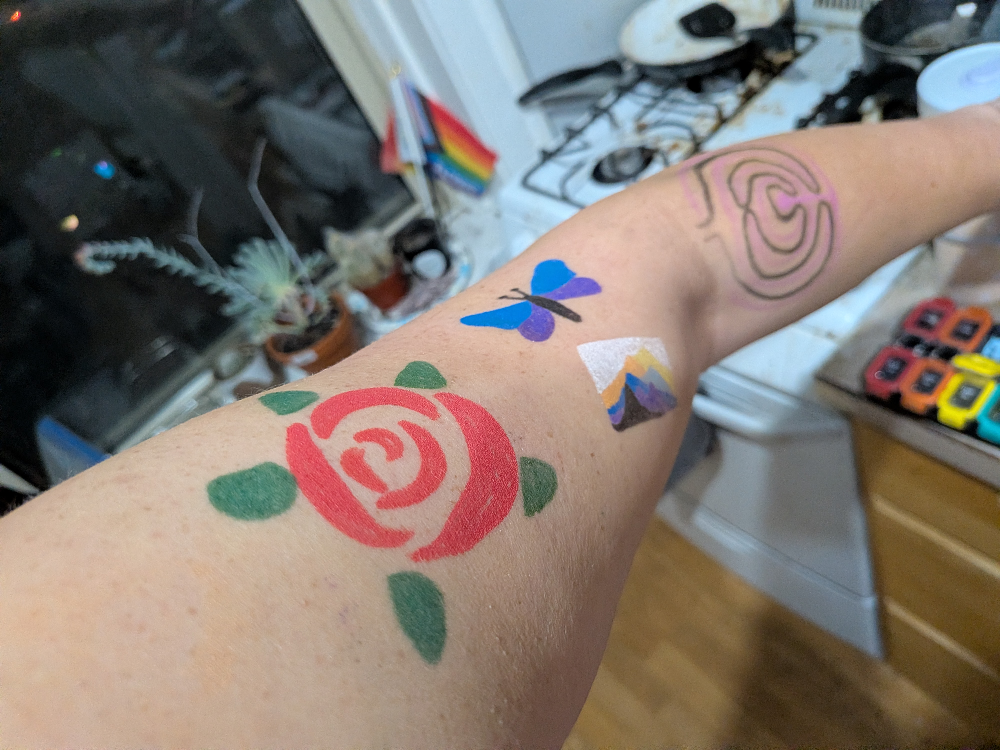
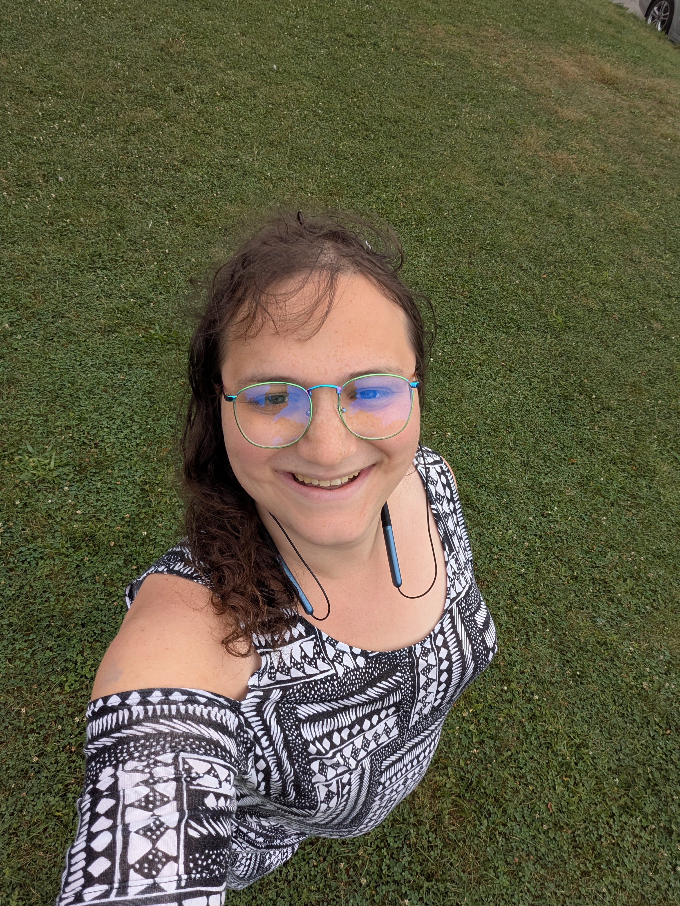
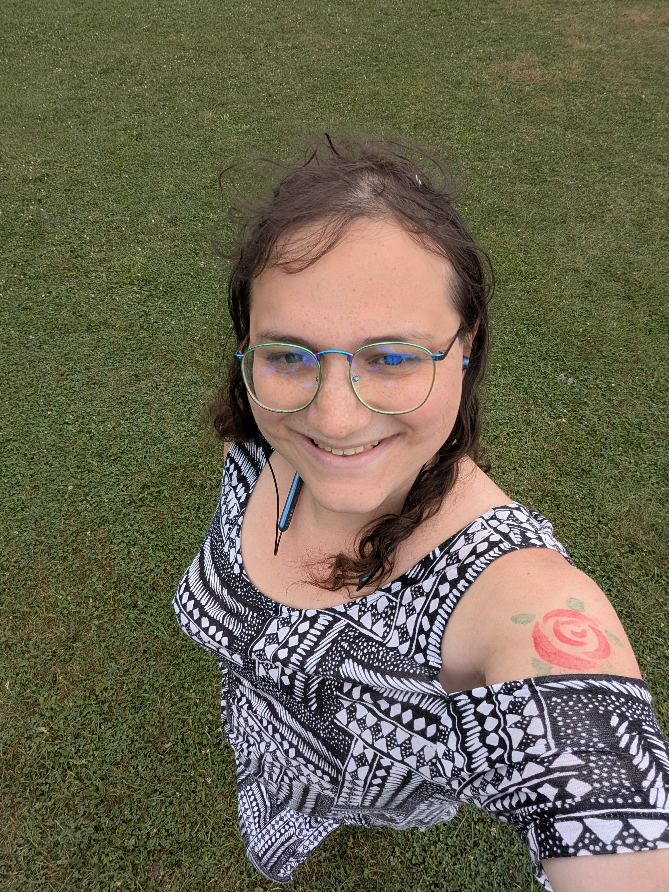
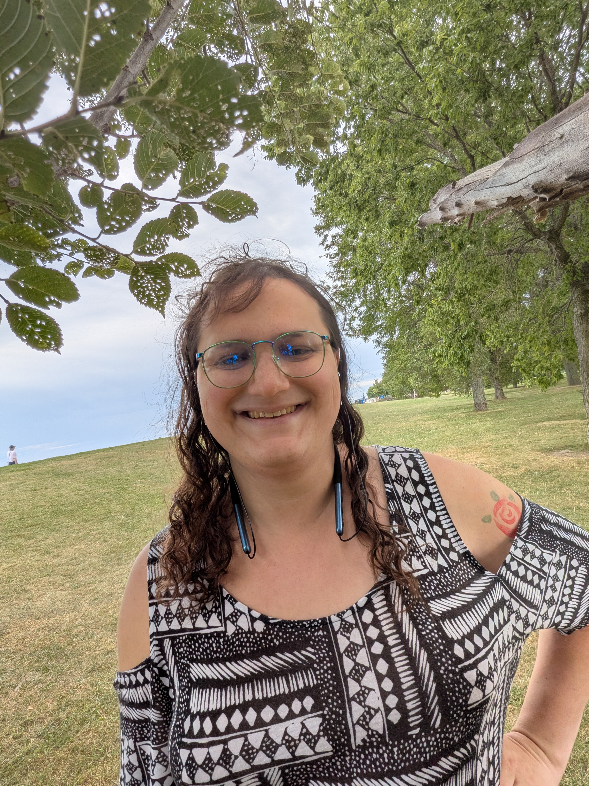

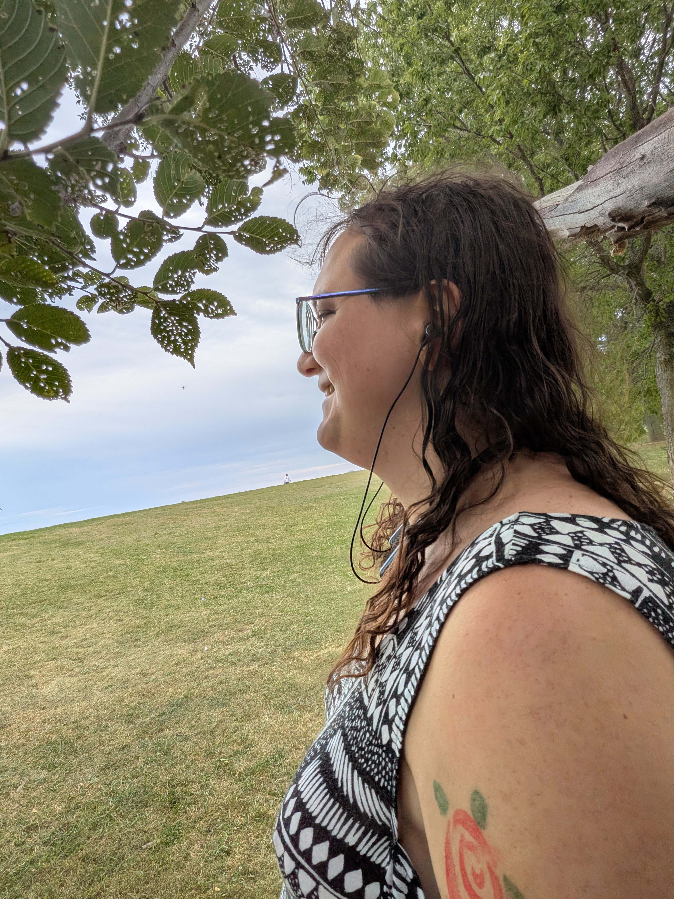
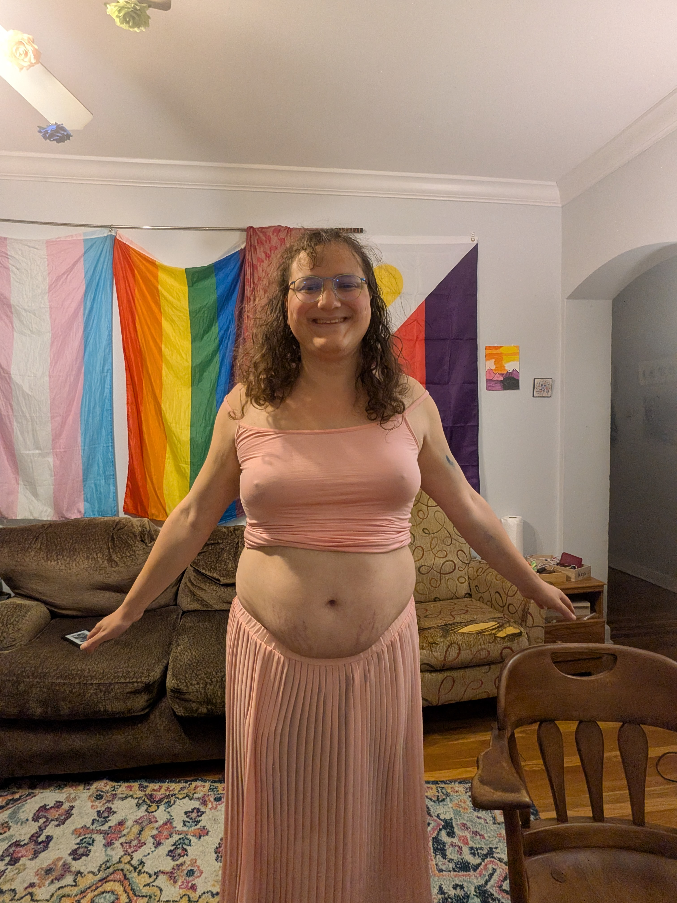
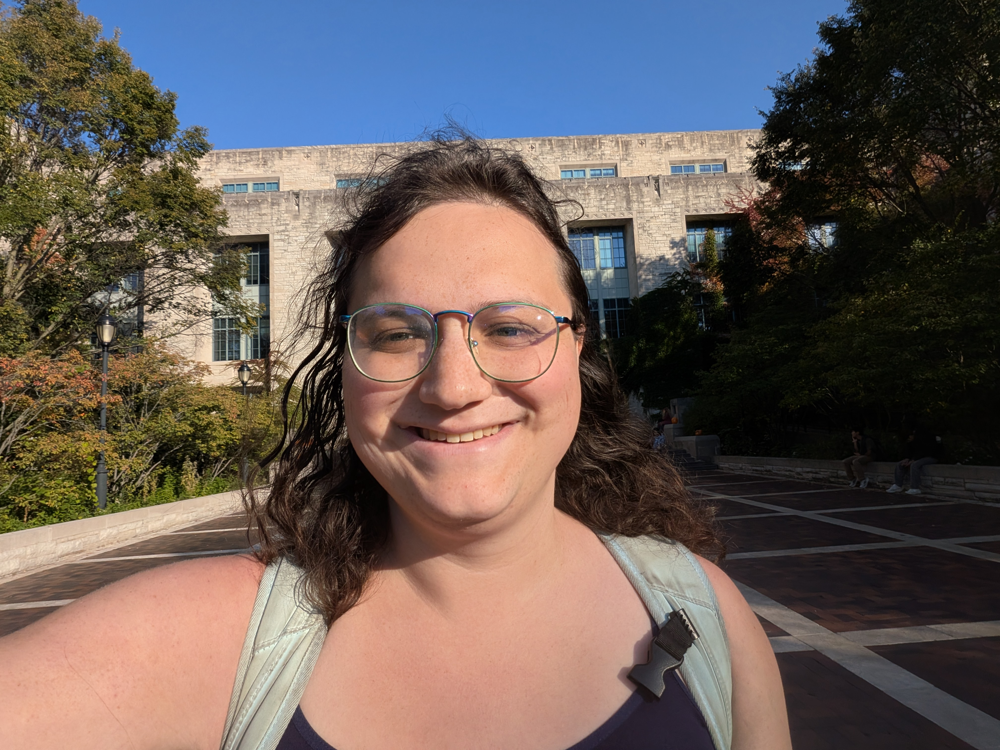
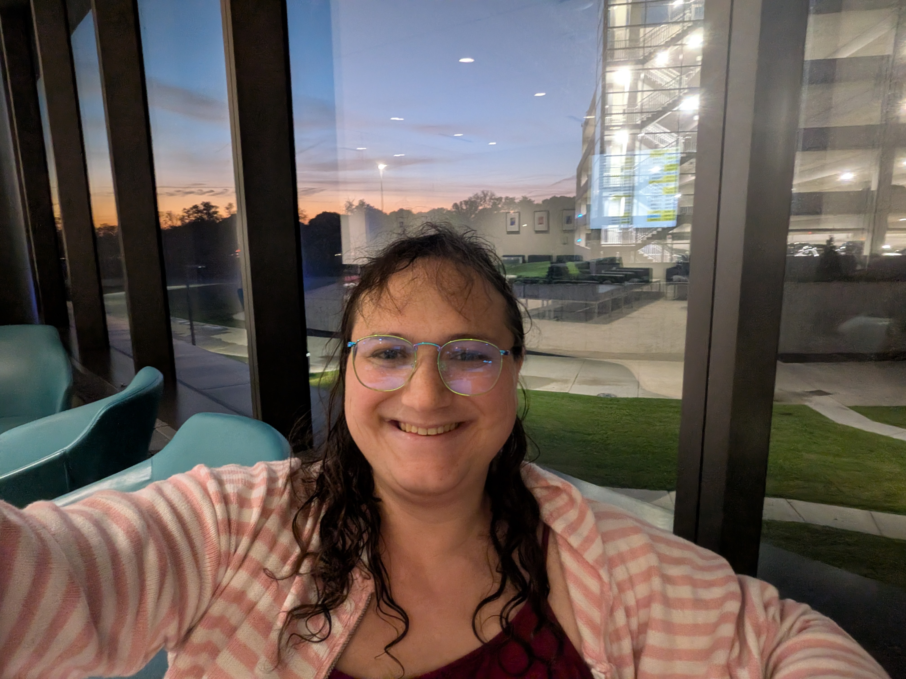
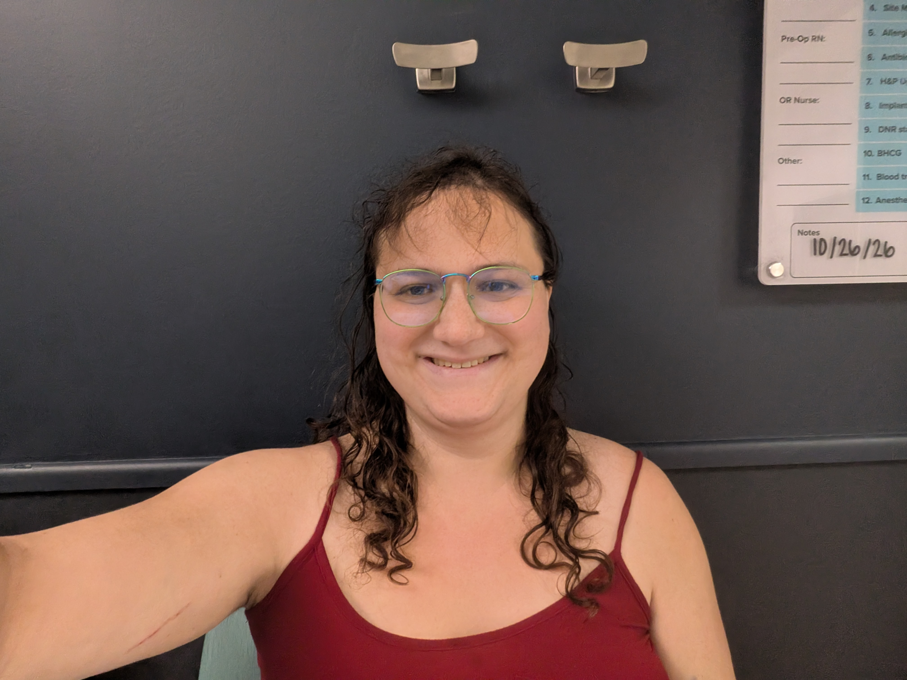
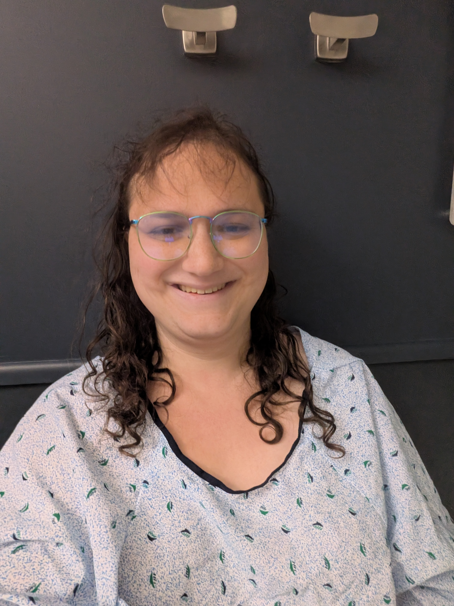
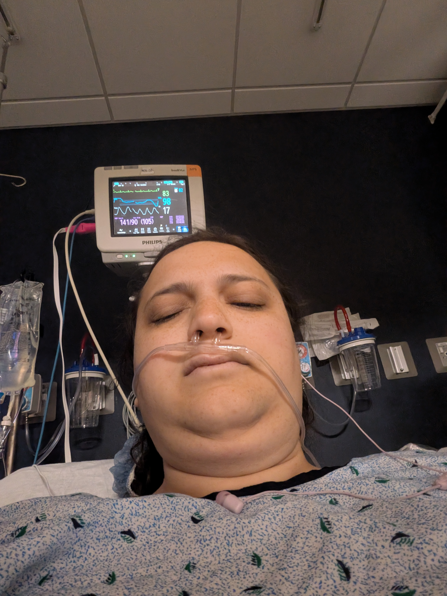
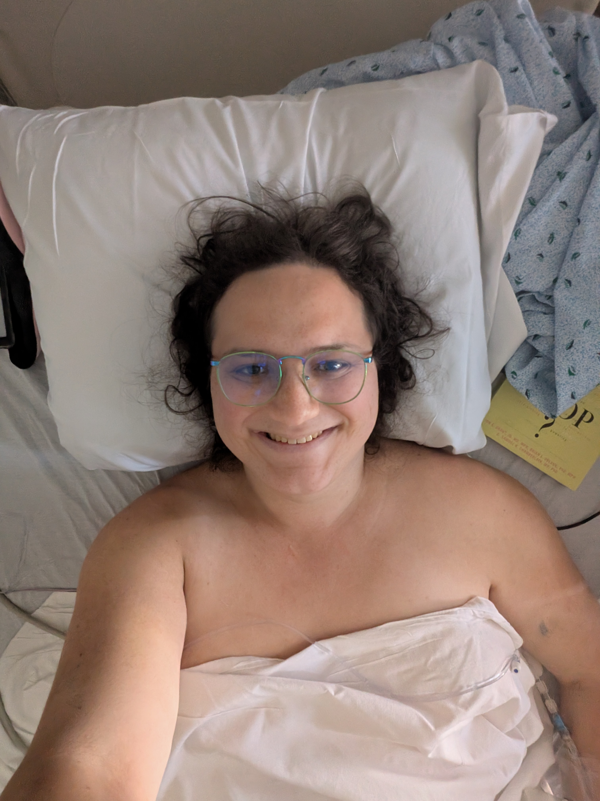
